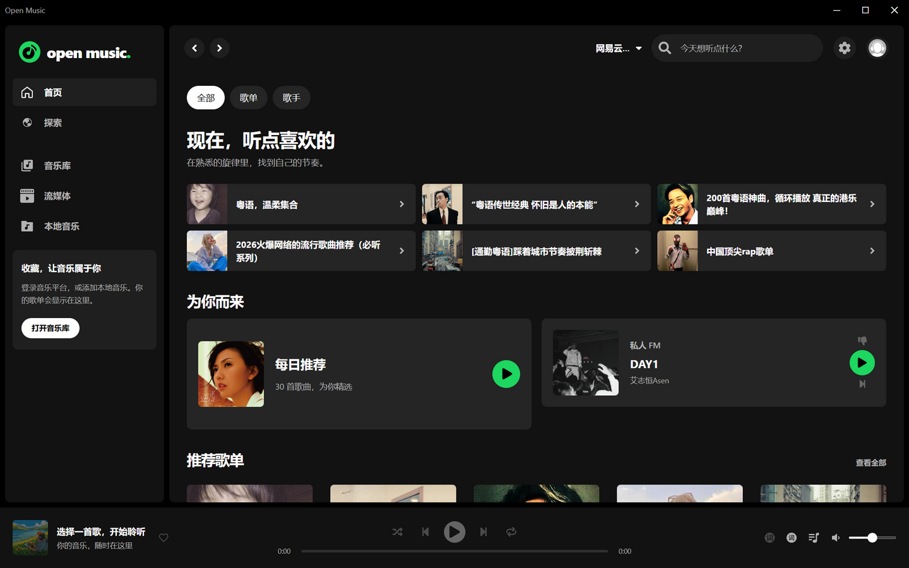

# Open Music

基于 [stark81/VutronMusic](https://github.com/stark81/VutronMusic) 定制的多数据源桌面音乐播放器。主界面参考 Spotify，播放与歌词页面参考网易云音乐，保留在线插件、本地曲库和流媒体服务的原有能力。

本仓库：[Ss-edge/open-music](https://github.com/Ss-edge/open-music)。技术栈为 Electron 37、Vue 3、TypeScript、Pinia 和 Vite。

## 界面预览



首页：固定侧栏、独立滚动的内容区、底部播放栏，以及头像旁的设置入口。


搜索：搜索图标与输入框共用一个胶囊外框，聚焦时显示统一边框；旁边保留来源选择。

## 主要功能

- **多来源播放**：保留网易云、酷狗插件，以及本地音乐、Emby、Jellyfin 和 Navidrome 的接入能力。在线服务的可用性取决于插件、服务地址与账户权限。
- **播放与同步歌词**：点击左下角歌曲封面直接进入歌词页，不受整条播放栏点击设置影响；支持收起、Esc 返回，以及原有的同步和逐字歌词能力。歌词内容取决于歌曲与来源。
- **桌面歌词**：锁定后光标静止时保持歌词可见，仅隐藏解锁控件；关闭或切换模式时清理旧窗口回调，避免旧窗口重新出现。
- **更直接的导航**：设置齿轮位于右上角头像旁。侧栏移除无点击行为的“你的音乐库”标题，保留实际的音乐库、本地音乐、流媒体和已保存歌单入口；入口随来源配置显示。
- **保留原有设置**：播放队列、音效、音量、主题与强调色设置继续使用原有状态和功能。新配置默认采用深色与绿色，已有配置仍遵循保存的偏好。
- **独立应用身份**：以 Open Music 名称和独立配置目录运行，可与原 VutronMusic 并行使用。首次运行需要重新配置来源或选择本地音乐目录，不会自动迁移旧应用的账户和曲库。

## 从源码运行

环境要求：**Node.js >= 22.6.0**、**Yarn 1.22.22**。

在项目根目录执行：

```sh
yarn install --frozen-lockfile
yarn dev
```

依赖安装包含原生模块重建，请等待安装完成后再启动。

Open Music 的页面服务使用 `http://localhost:41831`，开发 API 服务使用 `http://127.0.0.1:40002`。端口与应用身份说明见 [Open Music 分支说明](docs/src/spec/architecture/open-music-fork.md)。

## 构建 Windows 可运行目录

完成依赖安装后，在项目根目录依次执行：

```sh
yarn vue-tsc --noEmit
yarn vite build
yarn electron-builder --win --dir --config=buildAssets/builder/config.js --publish never
```

当前版本生成的程序入口为：

```text
release/3.3.5/win-unpacked/Open Music.exe
```

可以直接运行该文件，或双击根目录的 `启动 Open Music.cmd`。`win-unpacked` 是完整程序目录，运行时需要保留其中的 `resources`、DLL 等文件，不能只复制 EXE。

本仓库提供源码；上述命令在本机生成运行目录。构建产物和 `node_modules` 不存入 Git。

## 验证范围与已知限制

以下说明对应 2026-11-05 的本机记录，详细命令、结果及回滚方式见 [使用与验证记录](OPEN-MUSIC-使用说明.md)。

- 验证范围包括 Windows x64 的歌词可见性与窗口生命周期、封面进入歌词、键盘操作与焦点、路由和列表布局、本地扫描与播放、Electron 集成及安全检查、类型检查和生产打包。
- 验证使用合成的静音 WAV 与同步 LRC，没有使用个人账户或个人曲库。所有在线插件登录后的播放、云盘、收藏和个人推荐尚未完整验收。
- macOS、Linux 尚未打包或实机验证；Windows 的独占全屏、特殊置顶窗口、多显示器及全部缩放组合也未完整覆盖。
- 全仓 ESLint 仍有上游遗留错误和警告，构建也会输出部分上游依赖的弃用提示。具体范围见验证记录，不将局部检查结果等同于全仓通过。

**音质选择仍有限制。** 入口位于“设置 → 音乐设置 → 音质选择”，但当前网易云和酷狗插件仍使用固定的音质请求参数，尚未接入该选择项。调整界面选项不保证改变实际音质；本地音乐按源文件播放。本分支没有据此宣称提供无损或 Hi-Res 音源。

自动更新默认关闭，以免上游发行版覆盖本分支的界面改造；手动检查更新仍保留上游来源，使用前请确认目标版本。

## 项目文档

- [使用与验证记录](OPEN-MUSIC-使用说明.md)：启动方式、测试证据、未验证范围与回滚方法。
- [界面设计记录](DESIGN.md)：颜色、排版、布局、组件和交互约束。
- [产品目标与约束](PRODUCT.md)：当前改造范围及需保留的功能。
- [Open Music 分支说明](docs/src/spec/architecture/open-music-fork.md)：应用身份、端口与独立运行方式。
- [架构文档](docs/src/spec/architecture/index.md)：插件、数据库、IPC、状态与开发约定。

## 上游与许可

Open Music 基于 [stark81/VutronMusic](https://github.com/stark81/VutronMusic)，保留上游作者信息与历史记录。上游使用 [vutron](https://github.com/jooy2/vutron) 脚手架，相关界面与功能参考来源可查阅其原仓库说明。

根目录 [LICENSE](LICENSE) 为 MIT 许可文件；其中及各源码文件原有的版权和许可声明均予以保留。

上游 README 同时包含“仅用于个人学习研究，请勿用于商业用途”的提醒，这里保留该提醒；许可内容请直接查阅原文件。
